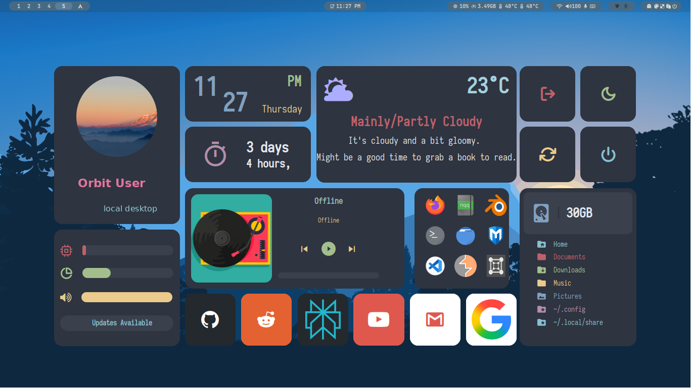
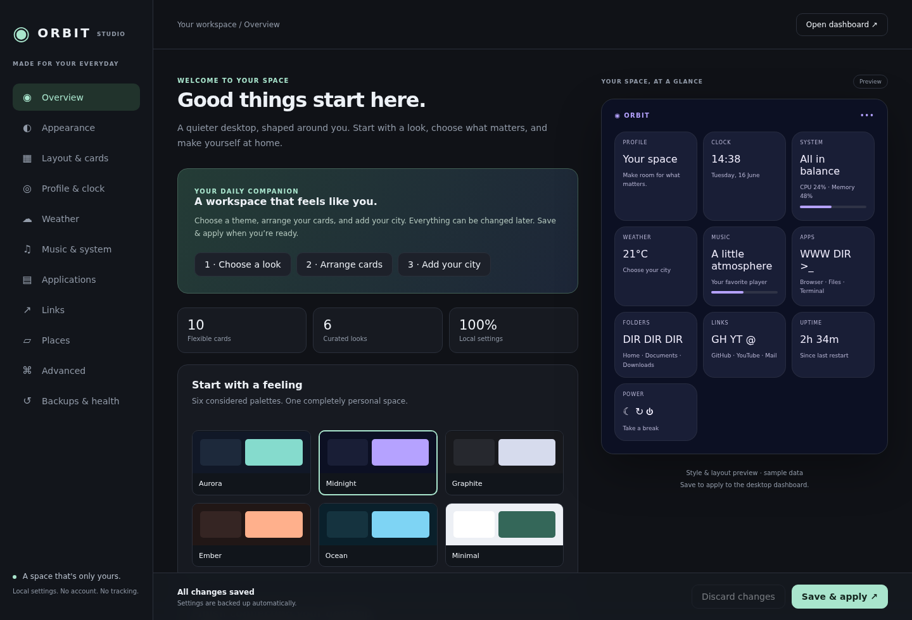
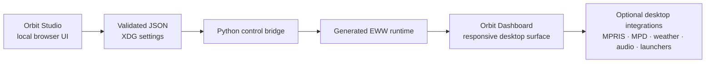

# Orbit Desktop

[](https://github.com/DragonPlayz-1/orbit-desktop/actions/workflows/ci.yml)
[](LICENSE)
[](docs/configuration.md)
[](https://github.com/elkowar/eww)

**A calm, configurable desktop surface for Linux.**

Orbit Desktop turns system signal into one deliberate place: a responsive EWW dashboard for telemetry, weather, music, shortcuts, folders, links, and safe power controls, plus a local browser studio for shaping the experience without editing code.

It is local-first by design. There is no account, cloud backend, analytics layer, or required API key. Your preferences stay on your machine and the optional integrations are detected at runtime.

<p align="center">
  
</p>

<p align="center">
  
</p>

## What makes it different

- **A real customization workflow** — Orbit Studio gives you visual controls for themes, spacing, cards, shortcuts, displays, weather, and recovery.
- **Portable runtime behavior** — XDG-aware paths, display discovery, bounded polling, optional integrations, and argument-safe launchers replace machine-specific assumptions.
- **Safe preferences** — versioned JSON, field validation, atomic saves, backups, import/export, and legacy migration without sourcing configuration as shell code.
- **Desktop-ready rendering** — responsive one-to-four-column layouts, readable large text, high contrast, reduced motion, X11 coverage, and layer-shell Wayland coverage.
- **Protected actions** — suspend, reboot, and poweroff are confirmation-gated by default, with an optional lock-before-suspend check.

## Supported environments

| Area | Supported target |
| --- | --- |
| Operating system | Linux |
| Display sessions | X11 and layer-shell-capable Wayland compositors such as Sway and Hyprland |
| Widget engine | EWW `0.6.0+` |
| Distributions | Arch Linux, Debian/Ubuntu, and Fedora guidance |
| Python | 3.9+ |
| Displays | Single and multiple monitors |
| Music | MPRIS through `playerctl`, MPD through `mpc` as fallback |
| Configuration | Orbit Studio or validated JSON |

Optional applications are detected at runtime. A missing player, audio backend, weather location, or desktop launcher does not prevent the dashboard from opening.

## Install

### 1. Install the prerequisites

Install EWW from your distribution or build a release with the X11 and/or Wayland backend enabled. Orbit does not replace your system EWW package.

Required runtime tools:

- Bash 4+
- Python 3.9+
- EWW `0.6.0+`, available as `eww`
- `curl`, `jq`, `flock`, and `timeout`
- GTK 3 and the font support provided by EWW

Useful optional tools include `playerctl`, `mpc`, `wpctl`, `pactl`, `pamixer`, `amixer`, `notify-send`, `zenity`, `kdialog`, `rofi`, `wofi`, `xdg-open`, `gio`, `xrandr`, `swaymsg`, `hyprctl`, and `wlr-randr`.

### 2. Clone and install

```bash
git clone https://github.com/DragonPlayz-1/orbit-desktop.git
cd orbit-desktop
./install/install.sh --setup
```

The installer validates the source tree and dependencies, backs up an existing installation, installs the runtime under `~/.config/eww/dashboard`, installs bundled fonts and desktop entries, creates validated settings, and runs a post-install diagnostic check.

If your distribution can install missing dependencies automatically:

```bash
./install/install.sh --install-deps
```

The upstream EWW `v0.6.0` source reports `eww 0.5.0` through its CLI. Orbit accepts that exact label as a compatibility exception and explains it in diagnostics; use a package or source release marked `v0.6.0` or newer.

### 3. Open the dashboard

```bash
~/.config/eww/dashboard/launch_dashboard --toggle
```

Open the customization studio at any time with:

```bash
~/.config/eww/dashboard/launch_dashboard --settings
```

`--setup` opens Studio after installation. The local server binds to loopback and closes when the Studio process exits.

## Orbit Studio

Studio is the normal way to customize Orbit. It keeps the approachable parts of a desktop settings app while leaving advanced commands explicit and opt-in.

### Appearance

- Six curated palettes: Aurora, Midnight, Graphite, Ember, Ocean, and Minimal.
- Dark/light mode, custom accent, opacity, radius, font, background, shadows, high contrast, and reduced motion.

### Layout

- One-to-four columns with compact, balanced, or spacious density.
- Automatic column reduction for smaller displays or larger text.
- Card visibility, labels, order, window size, monitor index, and compositor output selection.

### Desktop content

- Profile and clock.
- Weather search through Open-Meteo, with metric or imperial units and offline cache behavior.
- MPRIS-first music controls with MPD fallback and bounded album-art caching.
- System, disk, volume, update, and uptime cards.
- Installed application selection, browser/file-manager/terminal defaults, links, and folders.
- Confirmation-protected power actions.

### Recovery

- Automatic backups before successful changes.
- Restore the most recent versions, reset to defaults, export portable JSON, import settings, and run diagnostics.
- Legacy `dashboard.conf` is parsed as assignment data during migration and is never executed. Imported custom commands start disabled.

Settings are stored at:

```text
${XDG_CONFIG_HOME:-$HOME/.config}/eww-dashboard/settings.json
```

See [docs/configuration.md](docs/configuration.md) for the complete reference.

## Everyday controls

```bash
~/.config/eww/dashboard/launch_dashboard --open
~/.config/eww/dashboard/launch_dashboard --close
~/.config/eww/dashboard/launch_dashboard --reload
~/.config/eww/dashboard/launch_dashboard --diagnose
```

Example Hyprland binding:

```ini
bind = SUPER, D, exec, ~/.config/eww/dashboard/launch_dashboard
```

Example i3 binding:

```text
bindsym $mod+d exec --no-startup-id ~/.config/eww/dashboard/launch_dashboard
```

Useful EWW inspection commands:

```bash
eww --config ~/.cache/eww-dashboard/runtime state --all
eww --config ~/.cache/eww-dashboard/runtime active-windows
eww --config ~/.cache/eww-dashboard/runtime reload
```

## How it works



The launcher validates preferences, generates the active EWW configuration, waits for the daemon, and checks actual EWW window state instead of relying on a stale marker file.

## Diagnostics and troubleshooting

Run:

```bash
~/.config/eww/dashboard/scripts/dashboard_doctor
```

If the dashboard does not open:

1. Confirm `eww` is on `PATH` and meets the supported version requirement.
2. Run `dashboard_doctor` and check the reported display backend and dependencies.
3. Run `launch_dashboard --close`, then `launch_dashboard --reload`.
4. Inspect EWW state with `active-windows` and `state --all`.
5. Use Studio’s **Backups & health** page to restore or reset settings.

Power actions require a graphical confirmation tool by default. If no supported confirmation tool is installed, Orbit cancels the action rather than guessing.

## Development

The fast local gate does not require a graphical session:

```bash
tests/check.sh
```

Browser and compositor checks are also available:

```bash
# Playwright 1.58.2 installed outside the repository
NODE_PATH=/path/to/node_modules node tests/smoke_studio.cjs

# A real EWW binary and Xvfb
EWW_BIN=/path/to/eww xvfb-run -a -s '-screen 0 1366x768x24' \
  dbus-run-session -- python3 tests/smoke_eww.py

# Headless Sway with two monitors
EWW_BIN=/path/to/eww dbus-run-session -- python3 tests/smoke_wayland.py
```

CI runs the static checks, Studio browser flow, five X11 resolutions, and a two-monitor Wayland rendering pass. See [CONTRIBUTING.md](CONTRIBUTING.md) and [docs/release.md](docs/release.md) before changing runtime or EWW files.

## Uninstall

```bash
./install/uninstall.sh                # Keep settings, backups, fonts, and cache
./install/uninstall.sh --purge --yes  # Remove Orbit's saved data too
```

To stop Studio without uninstalling:

```bash
~/.config/eww/dashboard/scripts/dashboard_settings --stop
```

## Security and privacy

Orbit does not require credentials. Studio is loopback-only, uses a random per-session token, rejects unexpected Host and Origin headers, limits uploads and request sizes, and does not log request bodies. Custom shell commands live behind an explicit Advanced setting and are disabled after imports and migrations.

Read [SECURITY.md](SECURITY.md) before reporting a security-sensitive issue. Never commit `.env`, tokens, SSH keys, or machine-specific secrets.

## Credits and licensing

Orbit Desktop is released under the GPL-3.0 license. The dashboard structure was inspired by and contains material derived from [adi1090x/widgets](https://github.com/adi1090x/widgets); that upstream work is credited here and in [docs/THIRD_PARTY.md](docs/THIRD_PARTY.md). EWW, bundled fonts, icons, and artwork retain their own upstream licenses and attribution requirements.

See [LICENSE](LICENSE), [docs/THIRD_PARTY.md](docs/THIRD_PARTY.md), [docs/](docs/), and [CHANGELOG.md](CHANGELOG.md) for project history and release details.
